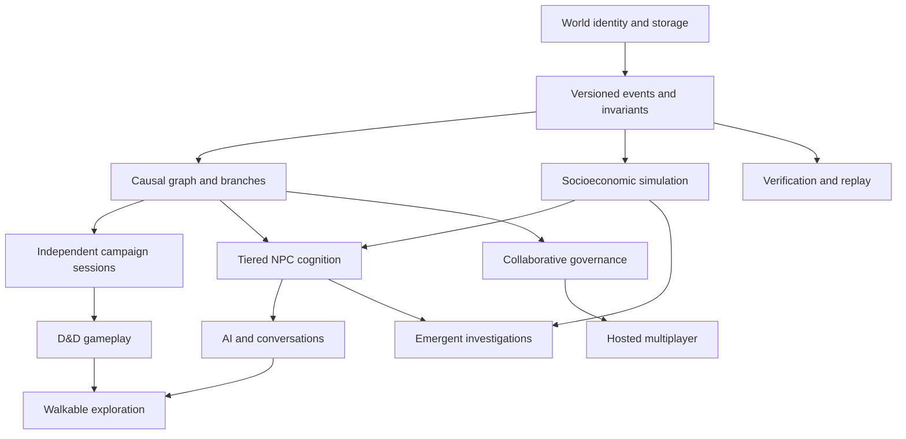

# Feature Catalogue, Scope and Ownership

> **Document ID:** LWE-FEAT-001 | **Interpretation:** Feature catalogue is a target state; it is not a claim that the features ship in v0.2.

## Capability map

| ID | Domain | Core features | Requirements | Target gate |
|---|---|---|---|---|
| FC-01 | World/state | identities, events, assets, branches, snapshots, replay, causal graphs | 01, 22, 27, 51–53, 55, 58–59 | P0 |
| FC-02 | Temporal engine | independent clocks, scheduling, partial ordering, loops, dilation, temporal travel | 02, 25, 54–57 | P0 base; P3 exotic |
| FC-03 | Simulation contracts | type systems, units, error bounds, numeric invariants | 03, 09, 58 | P0 |
| FC-04 | World construction | cosmology, worlds, maps, geology, procedural resolution and authored edits | 04, 05, 08, 20–22, 36 | P1 base; P3 complete |
| FC-05 | Economics | households, prices, producers, inventories, markets, taxes, debt and trade | 10, 42–43 | P1 base; P2 deep |
| FC-06 | NPC and organisations | identity, tiering, cognition, goals, memory, genealogy, organisational agents | 07, 17, 43–44, 48–49 | P1 identity; P2 complex |
| FC-07 | Biology/ecology | anatomy, disease, nutrition, ecosystems, weather, ageing and evolution | 18, 20, 45–46 | P1 simplified; P3 deep |
| FC-08 | Magic/metaphysics | hard magic, souls, gods, divinity and resurrection laws | 03, 08–09, 18–19, 47 | P2 |
| FC-09 | Knowledge & investigation | evidence, research, misinformation, intelligence, languages, secrets | 23–24, 33, 50 | P1 evidence; P2 system |
| FC-10 | D&D gameplay | 2014/2024 edition modules, homebrew, combat, items, downtime | 06, 12, 25 | P1 |
| FC-11 | Rendering/experience | narrative, maps, tactical, isometric/first/third-person, speech and voice | 13–14, 30, 49 | P1 first views; P2/P3 rich |
| FC-12 | Canon governance | GM hierarchy, roles, approvals, conflict and timeline UI | 01, 11, 22, 27–29 | P0 base; P1 UI |
| FC-13 | AI orchestration | provider adapters, local fallback, budgets, decision policies | 16, 44 | P1 narrow; P2 robust |
| FC-14 | Writers' Brains | author evidence corpus, council, proposals, adversarial critique | 40–41 | P2 |
| FC-15 | Civilisations and warfare | institutions, technological progress, doctrine, diplomacy and interstellar | 19–20, 23, 31–32 | P3 |
| FC-16 | Creators and IP | export/import, mod SDK, rights, asset pipeline, marketplace | 30, 38–39 | P2 exports; P3 marketplace |
| FC-17 | QA and observability | invariants, replay tests, stress runs, blind comparisons, diagnostics | 35, 57–60 | P0 throughout |
| FC-18 | Hosting and syncing | optional authoritative remote server, incremental data sync, conflict policy | 15, 27–28, 37 | P2 |

## Feature maturity states

`idea` → `specified` → `proof_of_concept` → `implemented` → `verified` → `released` → `deprecated`. Status of one feature does not apply automatically to its entire domain. A feature is **verified** only with reproducible evidence and clear scope. A deferred feature is not implicitly designed in detail.

## Feature dependency graph (illustrative)

## Functional acceptance example

A feature request “NPC can buy food” is accepted only if the following are true: NPC has a persistent ID, location and accessible stock; purchase requires legal transaction path; debit/credit and inventory changes are atomic; NPC's knowledge of prices is appropriately sourced; other campaigns see only branch-permitted effects; repeated request ID does not double-buy; replay reproduces ownership and money; observed dialogue reflects the committed outcome. This is how catalogue bullets become real working software.
