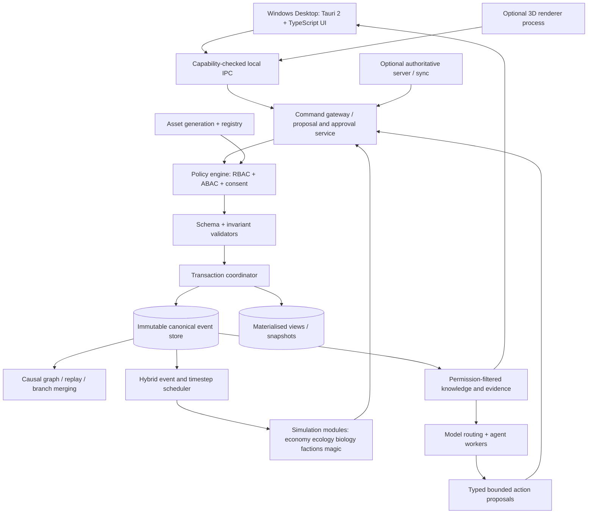

# System Architecture and Component Boundaries

> **Document ID:** LWE-ARCH-001 | **Decision basis:** 01, 06, 15–16, 27–28, 34, 36–37, 51–59 | **Status:** recommended target architecture, not an implemented production deployment.

## Logical architecture

**Architectural rule:** no UI, renderer, model or mod writes canonical state directly. All changes flow through validated commands, capability and policy checks, an atomic transaction coordinator, append-only events and projection updates. Events are authoritative *subject to source-authenticity controls and backups*; hashes alone are not signatures.

## Recommended implementation components

1. **Desktop shell:** Tauri 2, TypeScript UI, React or equivalent, accessible charts/maps, native file dialogs and OS keychain adapter. Restrict Tauri permissions and command exposure.
2. **Simulation core:** Rust crates organised by domains (`world-core`, `event-store`, `causality`, `scheduler`, `rules-dnd`, `knowledge`, `agents-policy`, `contracts`, `economy`, `ecology`, `magic`). Every crate publishes domain types, event schemas, reducer/transition logic, tests, and compatibility level.
3. **Local persistence:** SQLite WAL for one-authoritative-writer local workloads; read projections and bounded query indices. WAL does **not** support a multi-host shared network filesystem design (SQLite official documentation). Use a server-owned database for hosted worlds.
4. **Server option:** separate Rust service exposing authenticated world commands, streamed events and sync snapshots; storage PostgreSQL *candidate*, not approved selection. Hosted world's server is sole canonical writer.
5. **3D client:** game-renderer subprocess or native integration (Godot 4/Bevy/other to be benchmarked) with IPC. A web dashboard should not be mistaken for a complete 3D engine. Renderer must support shared interactable IDs, deterministic action interface and proper navmesh/collision.
6. **AI gateway:** provider adapters for Fable 5.2 and alternatives, optional local inference through installed runtime, schema-valid output, privacy filters, budgets, retries, logging and human approval. Models do not run transactional authority.
7. **Media jobs:** asynchronous asset generation for user-requested or approved content, storage/content-addressing, provenance, moderation/rights and 3D compile/validation queue. Content visibility restricted by campaign and role.
8. **Evaluation harness:** deterministic fixtures, model/retrieval tests, adversarial prompts, benchmark snapshots, failure injection, regression triage.

## Local runtime topology

Local Windows process model: Tauri UI ↔ Rust core service (in-process by default) ↔ SQLite database; optional renderer child process and optional local model server. Each process gets only its required capability. Network AI adapters are outbound and opt-in, controlled by privacy class and spending budget. OS file access through restricted dialogs, not broad filesystem execution from prompt-generated code.

## Hosted runtime topology

Authenticated clients ↔ API gateway ↔ authoritative world service ↔ transaction writer / database. AI/media/render workers consume queued scoped jobs and submit proposals. Event fan-out provides **role-filtered** projections. Clients may stage offline mutations as tentative signed/local records; after reconnection they are **proposals** until the server validates current head, policy and invariants. Conflict policy must distinguish player command retries from cross-branch historical edits. Presence/chat messages are ephemeral and not automatically world events.

## Quality attributes and trade-offs

| Attribute | Preferred mechanism | Cost/limitation |
|---|---|---|
| Auditability | append-only events, versioned validators, causal references | storage and schema migration |
| Local responsiveness | materialised projections, lazy indexes, bounded prompts | stale read risk if improper invalidation |
| Determinism | pinned seeds/algorithms, order-independent RNG streams, logged AI proposals | cannot make third-party model reasoning reproducible |
| Security | capability gateway, structured tool calls, data minimisation | extra engineering, latency |
| Scalability | dynamic simulation tiers, regional partitions, tiered storage | aggregate-vs-micro model divergence |
| Modularity | domain contract versioning and conformance tests | contract governance overhead |
| Portability | documented schemas, exports, optional server | difficult cross-version migration |

## Architectural decision candidates (ADRs required before build)

- ADR-001 Rust authoritative core vs extending Python reference: recommend Rust production, Python regression oracle, parity tests first.
- ADR-002 Tauri UI plus renderer subprocess vs unified Godot/Bevy shell: perform prototype comparison before committing renderer.
- ADR-003 SQLite local + PostgreSQL server candidate: choose after actual concurrent write, sync and hosting benchmarks.
- ADR-004 JSON Schema vs Protobuf or FlatBuffers: initially versioned JSON contracts for inspection and test fixtures; encode after profiling.
- ADR-005 causal graph storage: relational adjacency tables with indexed references first; dedicated graph database only if measurable need.
- ADR-006 event replay strategy: reducers pinned to event schema/version or migration/rewrite with independently verified reference snapshots.

## Failure domains

A bad AI output is a *rejected proposal*, not a world crash. A simulation invariant failure aborts its transaction and quarantines the affected domain/branch until recovery validates it. A renderer failure should allow narrative mode to continue. A hosted-server outage should permit approved offline local viewing but not pretend uncommitted shared-world actions succeeded. Asset generation failure leaves canonical geometry unaffected.
